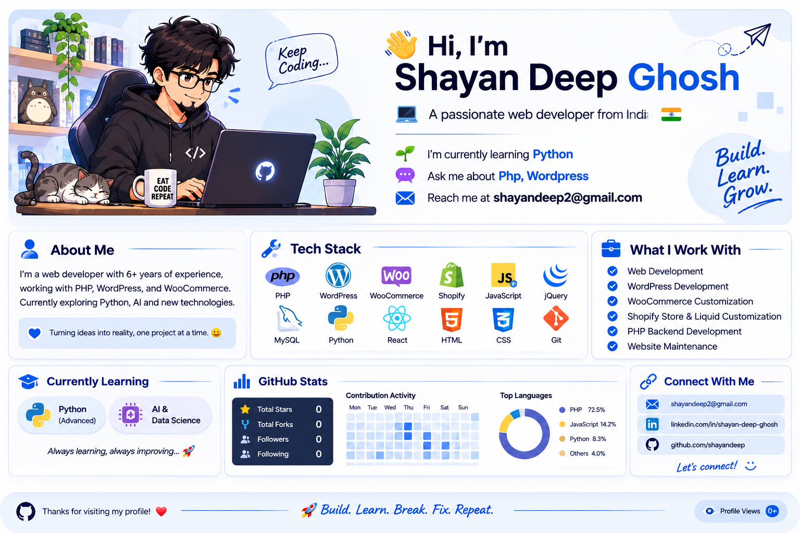

<h3>Web Developer from India 🇮🇳</h3>

Building for the web, learning new things, and improving one line of code at a time.

---

## 👨‍💻 About Me

- 💼 Web developer with 6+ years of experience
- 🔧 Working mainly with PHP, WordPress, and WooCommerce
- 🛍️ Shopify store and Liquid customization
- 🌱 Currently learning Python
- 🤖 Exploring AI and new technologies
- 💡 I enjoy building useful things and solving problems

---

## 🧰 Tech Stack

---

## 🔨 What I Do

- WordPress website development
- Custom WordPress plugin development
- PHP backend development
- WooCommerce customization
- Shopify sections and Liquid customization
- Website maintenance

---

## 🌱 Currently Learning

---

## 📈 GitHub Stats

 

---

## 🤝 Connect

<a href="mailto:shayandeep2@gmail.com">📧 Email</a> ·
<a href="https://www.linkedin.com/in/shayan-deep-ghosh-ba456829a/">LinkedIn</a> ·
<a href="https://github.com/YOUR_GITHUB_USERNAME">GitHub</a>

---

### ✨ Build. Learn. Break. Fix. Repeat. 🚀

